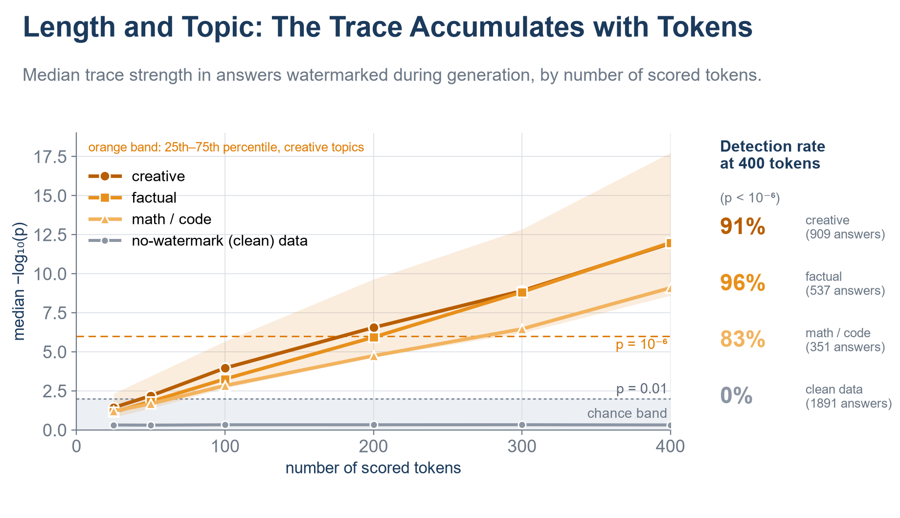
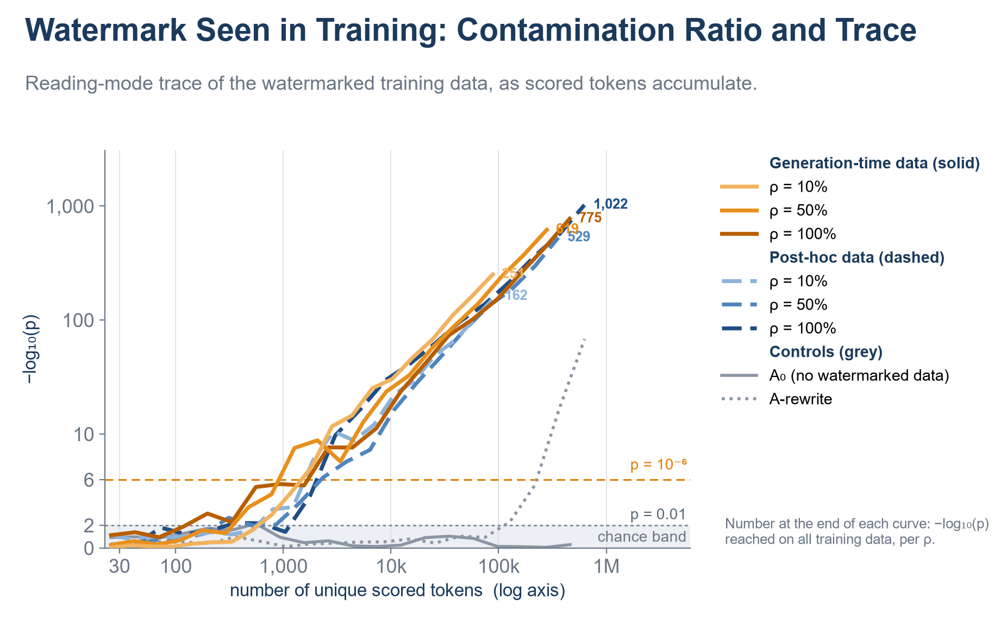
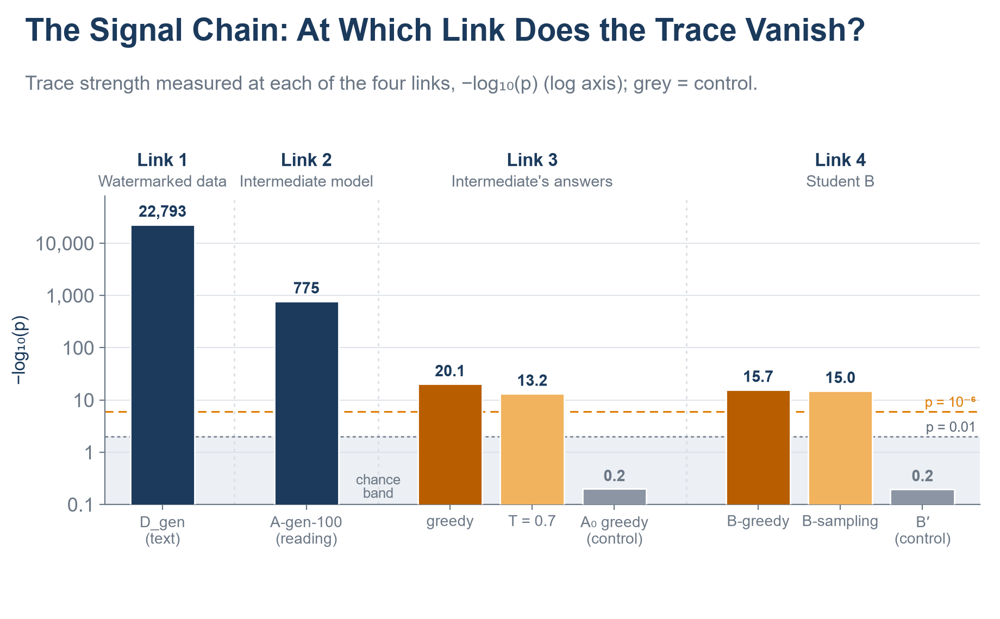

# llm-watermark-experiments

**English** · [Türkçe](README.tr.md)

[](https://github.com/erdem-erdem/llm-watermark-experiments/actions)
[](LICENSE)


Experiments on **LLM watermarking** and **watermark radioactivity** in Turkish: if a watermark is planted
in text, is it still detectable in a model that was *trained* on that text, and in a model trained on *that
model's* answers?

> 📖 **The full story — method, experiments, results and interpretation — is in the blog:**
> [🇬🇧 English](https://kureansiklopedi.com/en/detay/llm-watermarking-12-watermarking-working-principle) ·
> [🇹🇷 Türkçe](https://kureansiklopedi.com/tr/detay/llm-watermarking-12-iz-birakmak-calisma-prensipl-2)

## At a glance

- 🔬 **A complete, tested watermark implementation** — keyed Gumbel-max sampler, statistical detector with
  de-duplication, and a "reading mode" that tests a *model* instead of a text (`wm/`).
- 🧪 **The whole experiment pipeline** — data prep, generation (vLLM), fine-tuning, evaluation and analysis,
  from one command (`scripts/`).
- 📊 **All results as plain CSV/JSON** (`results/`) and **every figure in Turkish and English** (`figures/`).
- 💻 **Explore without a GPU** — rebuild the figures, run the tests and a toy demo on a laptop.

## A glimpse of the results

Three of the nine figures, rebuilt from the tables in this repo. Interpretation and the rest are in the blog.

**Trace strength grows with the number of scored tokens.** For answers watermarked while they were generated,
the median −log₁₀ p climbs with length; at 400 scored tokens the share of answers with p < 10⁻⁶ is 91 %
(creative), 96 % (factual) and 83 % (math/code) — and 0 % for unwatermarked answers.



**Reading a model, not a text.** Student models fine-tuned on mixtures containing watermarked data
(orange: watermarked during generation, blue: watermarked afterwards) are probed in reading mode. The
signal rises far above the p = 10⁻⁶ line as scored tokens accumulate, while the control trained without
watermarked data (grey, A₀) stays in the chance band.



**Following the signal down a chain.** The same measurement at four links — the watermarked data, the model
trained on it, that model's own answers, and a second student trained on those answers (log axis; grey = control).



All nine figures live in [`figures/en/main/`](figures/en/main) (and `figures/tr/main/` in Turkish), as PNG and SVG:
`fig_5_0` experiment chain · `fig_M_acilis` opening-line example · `fig_E0` test sanity check ·
`fig_E1_1`, `fig_E1_2` post-hoc rewriting · `fig_E2_1`, `fig_E2_2` generation-time watermark ·
`fig_E3_1` training · `fig_E4_1` chain.

## Quick start

| I want to… | Run | Needs |
|---|---|---|
| see a watermark get planted and detected | `python -m examples.toy_demo` | CPU, torch |
| run the unit tests | `make test` | CPU, torch |
| rebuild all figures (TR + EN) | `python -m analyze.make_figures` | CPU |
| reproduce the full experiments | `bash scripts/run_all.sh 4` (see [GPU section](#run-the-full-pipeline-gpu)) | 4 × H100 or similar |

## Concepts in five minutes

**1. Watermarking at generation time.** A language model picks each next token from a distribution `p`. We
replace the random draw with a *keyed* one:

```
window  = last k = 2 token ids
R_v     = hash(key, window, v) ∈ (0, 1)        for every vocabulary token v     (wm/prf.py)
next    = argmax_v  R_v ^ (1 / p_v)            Gumbel-max / exponential race    (wm/sampler.py)
```

Without the key this is an exact sample from `p`, so the text is distributed as usual. With the key, the
chosen tokens tend to have large `R`.

**2. Detection.** Recompute `R` for every token of a text with the key and score `s = −ln(1 − R)`. For
unwatermarked text `s ~ Exp(1)`, so the sum over `N` scored tokens follows `Gamma(N, 1)` and yields a p-value
(`wm/scoring.py`). We always report `−log₁₀ p` **together with `N`**. Repeated windows are skipped
(`wm/detect.py`), otherwise repeated n-grams would inflate the evidence.

**3. Post-hoc vs. generation-time.** The same scheme can be applied while a model *writes* an answer or while it
*rewrites* an existing one (`gen/gen_e1.py`).

**4. Radioactivity and "reading mode".** A model fine-tuned on watermarked text may drift toward
watermark-favoured tokens. To test this without generating text, feed text to the suspect model (one
teacher-forced pass), take its predicted token at each position, and score *that prediction* against the key
(`wm/reading_mode.py`).

Every parameter and rule is specified in [`SPEC.md`](SPEC.md) (Turkish).

## Repository layout

```
wm/            watermark core: PRF, sampler, scoring, detection, reading mode, vLLM adapter
  tests/       CPU unit tests (PRF bit-exactness, sampler↔detector consistency, …)
data/          dataset preparation + key selection; DATA_CARD.md
gen/           generation scripts (vLLM + custom logits processor)
train/         supervised fine-tuning (HF Trainer) + one YAML per trained model
eval/          GPQA-TR, math-olympiad accuracy, held-out loss, n-gram overlap check
analyze/       detection orchestration, tables, bilingual figure code (i18n.py, make_figures.py)
configs/       YAML configuration of every stage
scripts/       environment setup, GPU job runner, end-to-end run scripts
docker/        Dockerfile, self-check, fallback requirements
examples/      toy_demo.py — watermark + detect a toy model on CPU
results/       committed result tables and logs (CSV / JSON / JSONL / MD), by stage
figures/       tr/ and en/ → main/*.png|svg
SPEC.md        technical specification (Turkish)
RUN_MANUAL.md  how to run the pipeline (Turkish)      DOCKER_GUIDE.md  Docker walkthrough (English)
```

Stages, as named in code and in `results/`:

| Stage | What the code does |
|---|---|
| `E0` | sanity-checks the detector on clean models and wrong keys; selects the key |
| `E1` | rewrites existing answers with a watermark (post-hoc) and without one (control) |
| `E2` | generates answers with a watermark during generation; quality and diversity checks |
| `E3` | fine-tunes student models on data mixes of the above; measures detection in reading mode |
| `E4` | distills a further student from a student's outputs; measures detection along the chain |
| `mini` | the small demonstrations of the blog's introductory sections |

## Try it yourself (no GPU)

```bash
git clone https://github.com/erdem-erdem/llm-watermark-experiments.git
cd llm-watermark-experiments
python -m venv .venv && source .venv/bin/activate        # Windows: .venv\Scripts\activate
pip install torch --index-url https://download.pytorch.org/whl/cpu
pip install -r requirements-cpu-tests.txt
```

**Toy demo** (≈10 s). A random bigram model stands in for an LLM; the script samples text with the key and
runs the real detector from `wm/` with the right key, a wrong key, and on ordinary text:

```text
$ python -m examples.toy_demo
watermarked text, right key            N=394  -log10(p) =   480.86
watermarked text, WRONG key            N=394  -log10(p) =     0.20
ordinary text, right key               N=395  -log10(p) =     0.09
```

(A toy model is far peakier than a real LLM, so these magnitudes are not comparable to the blog's.)

**Use the pieces directly:**

```python
from wm.detect import detect_text

res = detect_text(prompt_ids=[...], answer_ids=[...], key=0x1234ABCD5678EF01, k=2)
print(res.N, res.neglog10p)            # scored tokens, −log10(p)
```

`answer_ids` are token ids — detection works on ids, not strings, because re-tokenising text can silently
change the windows (see `SPEC.md`, rule 2).

**Run the tests:** `make test` (or `python -m wm.tests.test_prf`, …).

## Rebuild the figures

All figures are drawn from the committed tables in `results/`, in both languages:

```bash
pip install -r requirements-figures.txt
python -m analyze.make_figures              # tr + en, about a minute
python -m analyze.make_figures --lang en    # one language
python -m analyze.blog_figures --lang en E0 E1_1     # selected figures only
```

Output: `figures/<lang>/main/*.png|svg`. The Turkish model outputs shown inside some figures (example texts,
tokens) are data and stay Turkish in the English versions. The figures need real data: if a results file is
missing, the script stops and names the file and the stage that produces it — nothing is ever filled in with
placeholders. To add or fix a translation, edit the inline `L("Türkçe", "English")` pair in `analyze/blog_*.py`.

## Run the full pipeline (GPU)

The study ran on **4 × H100** (80 GB). One GPU works but is slow; the scripts split heavy jobs over however many
GPUs you give them. Budget roughly 45 GB for the Hugging Face cache, 20–25 GB for the Docker image and a few GB
for trained checkpoints.

**Recommended: Docker** (avoids vLLM/torch/CUDA mismatches; full walkthrough in [`DOCKER_GUIDE.md`](DOCKER_GUIDE.md)):

```bash
docker build -f docker/Dockerfile -t llm-watermark-experiments:latest .
docker run --rm --gpus all --ipc=host llm-watermark-experiments:latest python /opt/selfcheck.py   # must pass first

export HF_TOKEN=hf_xxx                       # some datasets are gated; see "Data, models and licenses"
alias wm='docker run --rm --gpus all --ipc=host --ulimit memlock=-1 --ulimit stack=67108864 \
  -e HF_TOKEN -v "$PWD":/workspace -v "$HOME/hf_cache":/hf llm-watermark-experiments:latest'

wm bash scripts/run_smoke_all.sh             # small end-to-end check (~1 h incl. downloads)
wm bash scripts/run_all.sh 4                 # data, keys, E1 sweep + automatic setting choice, then continues
# run_all.sh calls scripts/run_e1_full.sh itself (E2–E4, evaluations, tables, figures);
# you only run it by hand after `E1_GATE=manual` or to resume:  wm bash scripts/run_e1_full.sh 4
```

**Without Docker:** `bash scripts/setup_env.sh` (see [`RUN_MANUAL.md`](RUN_MANUAL.md) §1). The version lock file
`docker/requirements.lock.txt` is *not* shipped — generate it from a working environment with the command in
`DOCKER_GUIDE.md` §4, or build from the loose list with `--build-arg REQ_FILE=requirements.txt`.

Every stage is idempotent: a stage whose outputs exist is skipped (`--force` redoes it). Each command is appended
to `results/LOG.md`; library versions, seeds and durations go to `results/run_manifest.json`. Stage-by-stage
detail, GPU distribution and troubleshooting: `RUN_MANUAL.md` (Turkish) and `DOCKER_GUIDE.md`.

## What is committed in `results/`

Per-stage CSV / JSON / JSONL / Markdown outputs: detection tables and curves, p-value distributions, evaluation
scores, generation samples, the key-selection record, the run log and manifest.

Not committed (too large or reproducible): model checkpoints, the generated datasets `data/*.jsonl` (rebuild with
`python -m data.prep_data`), `.npz` prediction arrays, raw per-job logs, and the raw post-hoc generation shards
(`results/E1/full_parts/`). The pipeline rebuilds them; the committed tables are what the figures are drawn from.

## Data, models and licenses

| Resource | Use | License / note |
|---|---|---|
| [`turkish-nlp-suite/InstrucTurca`](https://huggingface.co/datasets/turkish-nlp-suite/InstrucTurca) | instruction data (streamed, filtered subset) | CC BY-SA 4.0 — attribution required; see `data/DATA_CARD.md` |
| [`ytu-ce-cosmos/tubitak-science-olympiad-tr`](https://huggingface.co/datasets/ytu-ce-cosmos/tubitak-science-olympiad-tr) | math-olympiad quality check | see dataset card |
| [`ytu-ce-cosmos/gpqa-extended_tr`](https://huggingface.co/datasets/ytu-ce-cosmos/gpqa-extended_tr) | downstream evaluation | may be gated: accept its terms and pass `HF_TOKEN` |
| Qwen3.5 (0.8B, 2B, 2B-Base, 4B, 9B) | generators / students | see each model card on Hugging Face |
| `intfloat/multilingual-e5-large` | semantic similarity | see model card |

No model weights or dataset dumps are redistributed here. The code is released under the [MIT License](LICENSE).

## Notes and known quirks

- **`aime_*` names are legacy.** The specification first planned an `aime25-tr` math set. The actual runs use
  `ytu-ce-cosmos/tubitak-science-olympiad-tr` (`ortaokul_matematik` split, rows with purely numeric answers).
  Files and functions named `aime_*` / `AIME25-TR` (e.g. `eval/aime_tr.py`, `results/E2/aime_summary.json`)
  evaluate that olympiad set, not AIME.
- **Comments and docstrings are mostly Turkish**; identifiers and the READMEs are not. `SPEC.md` and `RUN_MANUAL.md`
  are Turkish; `DOCKER_GUIDE.md` is English.
- Scripts expect UTF-8; on Windows set `PYTHONIOENCODING=utf-8` (the `Makefile` does).
- Figures use Arial when installed and fall back to DejaVu Sans; SVGs keep text as text.
- `gen/gen_opening.py` expects your own `data/opening_draft.txt` (first paragraph = the quote, blank line, then the
  paragraph); the file is not shipped, and its committed output is under `results/mini/`.
- `python -m analyze.summary` writes `results/SUMMARY.md`, but its E3 table has not been updated for the final
  reading-mode outputs, so the file is not committed.
