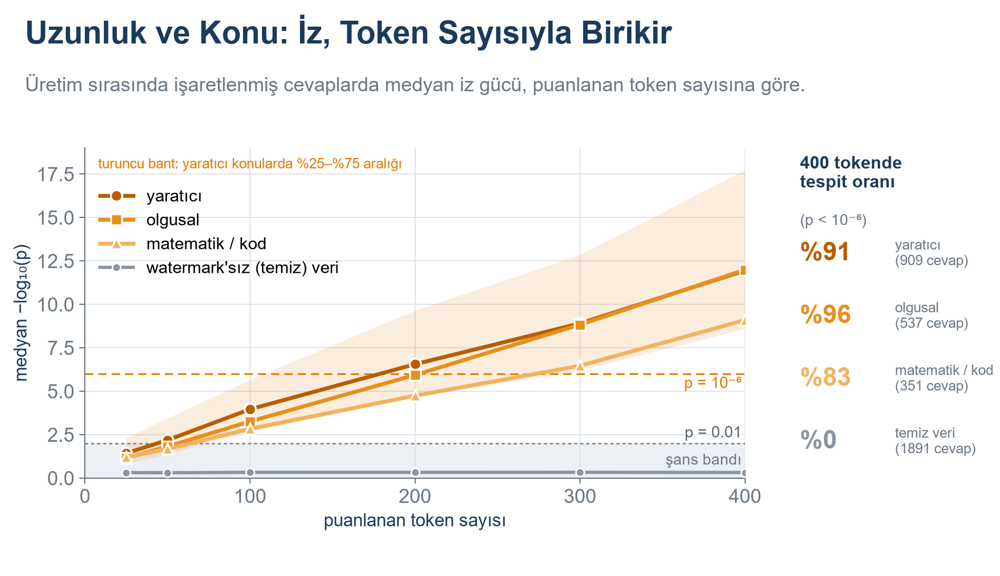
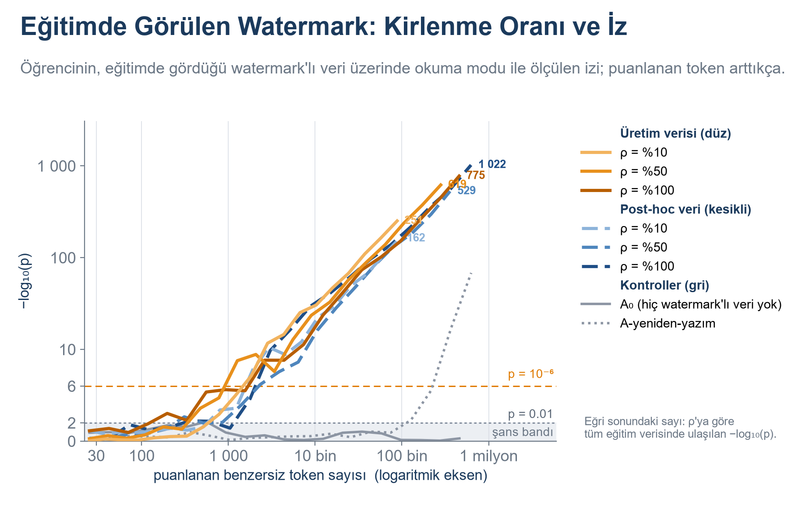
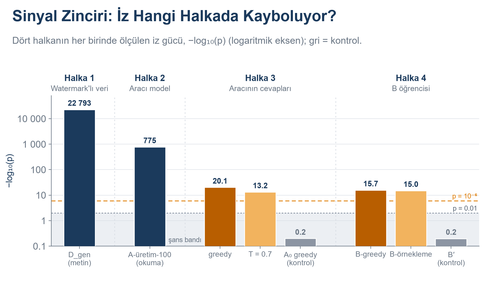

# llm-watermark-experiments

[English](README.md) · **Türkçe**

[](https://github.com/erdem-erdem/llm-watermark-experiments/actions)
[](LICENSE)


Türkçe'de **LLM watermark'ı** ve **watermark radyoaktivitesi** deneyleri: metne bir watermark yerleştirilirse,
o metinle *eğitilmiş* bir modelde ve *o modelin cevaplarıyla* eğitilmiş bir modelde hâlâ tespit edilebilir mi?

> 📖 **Yöntem, deneyler, sonuçlar ve yorumların tamamı blogda:**
> [🇹🇷 Türkçe](https://kureansiklopedi.com/tr/detay/llm-watermarking-12-iz-birakmak-calisma-prensipl-2) ·
> [🇬🇧 English](https://kureansiklopedi.com/en/detay/llm-watermarking-12-watermarking-working-principle)

## Bir bakışta

- 🔬 **Eksiksiz, test edilmiş bir watermark uygulaması** — anahtarlı Gumbel-max örnekleyici, tekilleştirmeli
  istatistiksel dedektör ve metin yerine *modeli* sınayan "okuma modu" (`wm/`).
- 🧪 **Tüm deney hattı** — veri hazırlama, üretim (vLLM), ince ayar, değerlendirme ve analiz; tek komutla (`scripts/`).
- 📊 **Tüm sonuçlar düz CSV/JSON** (`results/`) ve **her şekil Türkçe ve İngilizce** (`figures/`).
- 💻 **GPU olmadan keşfedin** — şekilleri yeniden üretin, testleri ve oyuncak demoyu dizüstünde çalıştırın.

## Sonuçlardan bir kesit

Dokuz şeklin üçü; bu depodaki tablolardan yeniden üretilebilir. Yorum ve geri kalanı blogda.

**İz gücü, puanlanan token sayısıyla artar.** Üretim sırasında işaretlenen cevaplarda medyan −log₁₀ p uzunlukla
yükselir; 400 puanlanan tokende p < 10⁻⁶ olan cevapların payı %91 (yaratıcı), %96 (olgusal) ve %83 (matematik/kod);
watermark'sız cevaplarda %0.



**Metni değil, modeli okumak.** Watermark'lı veri içeren karışımlarla ince ayar görmüş öğrenci modeller okuma
modunda sınanır (turuncu: üretim sırasında, mavi: sonradan işaretlenmiş). Puanlanan token biriktikçe sinyal
p = 10⁻⁶ çizgisinin çok üstüne çıkar; watermark'lı veri görmeyen kontrol (gri, A₀) şans bandında kalır.



**Sinyali bir zincir boyunca izlemek.** Aynı ölçüm dört halkada: watermark'lı veri, onunla eğitilen model, o modelin
kendi cevapları ve bu cevaplarla eğitilen ikinci öğrenci (log eksen; gri = kontrol).



Dokuz şeklin hepsi PNG ve SVG olarak [`figures/tr/main/`](figures/tr/main) (ve İngilizce `figures/en/main/`)
altındadır: `fig_5_0` deney zinciri · `fig_M_acilis` açılış örneği · `fig_E0` testin sağlaması ·
`fig_E1_1`, `fig_E1_2` post-hoc yeniden yazım · `fig_E2_1`, `fig_E2_2` üretim sırasında watermark ·
`fig_E3_1` eğitim · `fig_E4_1` zincir.

## Hızlı başlangıç

| Şunu yapmak istiyorum… | Komut | Gereken |
|---|---|---|
| watermark'ın yerleştirilip tespit edilmesini görmek | `python -m examples.toy_demo` | CPU, torch |
| birim testlerini çalıştırmak | `make test` | CPU, torch |
| tüm şekilleri (TR + EN) yeniden üretmek | `python -m analyze.make_figures` | CPU |
| deneylerin tamamını yeniden üretmek | `bash scripts/run_all.sh 4` ([GPU bölümü](#tam-hattı-çalıştırın-gpu)) | 4 × H100 veya benzeri |

## Beş dakikada kavramlar

**1. Üretim sırasında watermark.** Bir dil modeli her sonraki tokenı `p` dağılımından seçer. Rastgele çekimi
*anahtarlı* bir çekimle değiştiririz:

```
pencere = son k = 2 token kimliği
R_v     = hash(key, pencere, v) ∈ (0, 1)       her sözlük tokenı v için        (wm/prf.py)
sonraki = argmax_v  R_v ^ (1 / p_v)            Gumbel-max / üstel yarış        (wm/sampler.py)
```

Anahtar olmadan bu, `p`'den birebir örneklemedir; metin her zamanki dağılımdadır. Anahtarla bakıldığında
seçilen tokenların `R` değerleri büyük olma eğilimindedir.

**2. Tespit.** Metindeki her tokenın `R` değeri anahtarla yeniden hesaplanır ve `s = −ln(1 − R)` skoru alınır.
Watermark'sız metinde `s ~ Exp(1)` olduğundan `N` puanlanan tokenın toplamı `Gamma(N, 1)` izler ve p-değeri
verir (`wm/scoring.py`). Her zaman `−log₁₀ p` **ile `N` birlikte** raporlanır. Tekrar eden pencereler atlanır
(`wm/detect.py`); aksi halde tekrar eden n-gramlar kanıtı şişirir.

**3. Post-hoc ve üretim sırasında.** Aynı şema bir model cevap *yazarken* ya da var olan bir cevabı *yeniden
yazarken* uygulanabilir (`gen/gen_e1.py`).

**4. Radyoaktivite ve "okuma modu".** Watermark'lı metinle ince ayar görmüş bir model, watermark'ın tercih ettiği
tokenlara kayabilir. Bunu metin üretmeden sınamak için metin şüpheli modele verilir (tek ileri geçiş, teacher
forcing), her konumda modelin tahmin ettiği token alınır ve *bu tahmin* anahtara göre puanlanır
(`wm/reading_mode.py`).

Her parametre ve kural [`SPEC.md`](SPEC.md) içinde tanımlıdır.

## Depo yapısı

```
wm/            watermark çekirdeği: PRF, örnekleyici, skor, tespit, okuma modu, vLLM adaptörü
  tests/       CPU birim testleri (PRF bit-düzeyi doğruluk, örnekleyici↔dedektör tutarlılığı, …)
data/          veri hazırlama + anahtar seçimi; DATA_CARD.md
gen/           üretim betikleri (vLLM + özel logits processor)
train/         SFT (HF Trainer) + eğitilen her model için bir YAML
eval/          GPQA-TR, matematik olimpiyatı doğruluğu, ayrılmış küme kaybı, n-gram örtüşme kontrolü
analyze/       tespit orkestrasyonu, tablolar, iki dilli şekil kodu (i18n.py, make_figures.py)
configs/       her aşamanın YAML yapılandırması
scripts/       ortam kurulumu, GPU iş koşucusu, uçtan uca koşum betikleri
docker/        Dockerfile, öz-denetim, yedek requirements
examples/      toy_demo.py — oyuncak modele watermark + tespit (CPU)
results/       işlenmiş sonuç tabloları ve kayıtlar (CSV / JSON / JSONL / MD), aşamaya göre
figures/       tr/ ve en/ → main/*.png|svg
SPEC.md        teknik şartname (Türkçe)
RUN_MANUAL.md  hattın çalıştırılması (Türkçe)      DOCKER_GUIDE.md  Docker anlatımı (İngilizce)
```

Kodda ve `results/` içinde geçen aşama adları:

| Aşama | Kod ne yapar |
|---|---|
| `E0` | dedektörü temiz modellerde ve yanlış anahtarlarla sınar; anahtarı seçer |
| `E1` | var olan cevapları watermark'lı (post-hoc) ve watermark'sız (kontrol) yeniden yazar |
| `E2` | üretim sırasında watermark'la cevap üretir; kalite ve çeşitlilik kontrolleri |
| `E3` | yukarıdakilerin karışımlarıyla öğrenci modeller eğitir; okuma modunda tespiti ölçer |
| `E4` | bir öğrencinin çıktılarından yeni bir öğrenci damıtır; zincir boyunca tespiti ölçer |
| `mini` | blogun giriş bölümlerindeki küçük gösterimler |

## Kendiniz deneyin (GPU gerekmez)

```bash
git clone https://github.com/erdem-erdem/llm-watermark-experiments.git
cd llm-watermark-experiments
python -m venv .venv && source .venv/bin/activate        # Windows: .venv\Scripts\activate
pip install torch --index-url https://download.pytorch.org/whl/cpu
pip install -r requirements-cpu-tests.txt
```

**Oyuncak demo** (≈10 sn). Rastgele bir bigram modeli LLM'in yerini tutar; betik anahtarla metin örnekler ve `wm/`
içindeki gerçek dedektörü doğru anahtarla, yanlış anahtarla ve sıradan metin üzerinde çalıştırır:

```text
$ python -m examples.toy_demo
watermarked text, right key            N=394  -log10(p) =   480.86
watermarked text, WRONG key            N=394  -log10(p) =     0.20
ordinary text, right key               N=395  -log10(p) =     0.09
```

(Oyuncak model gerçek bir LLM'den çok daha "sivri"dir; büyüklükler blogdakilerle kıyaslanamaz.)

**Parçaları doğrudan kullanın:**

```python
from wm.detect import detect_text

res = detect_text(prompt_ids=[...], answer_ids=[...], key=0x1234ABCD5678EF01, k=2)
print(res.N, res.neglog10p)            # puanlanan token sayısı, −log10(p)
```

`answer_ids` token kimlikleridir — tespit metinle değil kimliklerle çalışır; çünkü metni yeniden tokenlaştırmak
pencereleri sessizce değiştirebilir (bkz. `SPEC.md`, kural 2).

**Testleri çalıştırın:** `make test` (ya da `python -m wm.tests.test_prf` vb.).

## Şekilleri yeniden üretin

Tüm şekiller, `results/` içindeki işlenmiş tablolardan iki dilde çizilir:

```bash
pip install -r requirements-figures.txt
python -m analyze.make_figures              # tr + en, bir dakika kadar
python -m analyze.make_figures --lang tr    # tek dil
python -m analyze.blog_figures --lang tr E0 E1_1     # yalnız seçili şekiller
```

Çıktı: `figures/<dil>/main/*.png|svg`. Bazı şekillerin içindeki Türkçe model çıktıları (örnek metinler, tokenlar)
veridir ve İngilizce sürümlerde de Türkçe kalır. Şekiller gerçek veri ister: bir sonuç dosyası yoksa betik durur,
dosyayı ve onu üreten aşamayı söyler — hiçbir şey yer tutucu değerle doldurulmaz. Çeviri eklemek ya da düzeltmek için
`analyze/blog_*.py` içindeki `L("Türkçe", "English")` çiftini düzenleyin.

## Tam hattı çalıştırın (GPU)

Çalışma **4 × H100** (80 GB) üzerinde yapıldı. Tek GPU çalışır ama yavaştır; betikler ağır işleri verdiğiniz GPU
sayısına böler. Yaklaşık 45 GB Hugging Face önbelleği, 20–25 GB Docker imajı ve birkaç GB eğitilmiş kontrol noktası
hesaplayın.

**Önerilen: Docker** (vLLM/torch/CUDA uyumsuzluklarını önler; ayrıntı [`DOCKER_GUIDE.md`](DOCKER_GUIDE.md), İngilizce):

```bash
docker build -f docker/Dockerfile -t llm-watermark-experiments:latest .
docker run --rm --gpus all --ipc=host llm-watermark-experiments:latest python /opt/selfcheck.py   # önce bu geçmeli

export HF_TOKEN=hf_xxx                       # bazı veri kümeleri kapılıdır; bkz. "Veri, modeller ve lisanslar"
alias wm='docker run --rm --gpus all --ipc=host --ulimit memlock=-1 --ulimit stack=67108864 \
  -e HF_TOKEN -v "$PWD":/workspace -v "$HOME/hf_cache":/hf llm-watermark-experiments:latest'

wm bash scripts/run_smoke_all.sh             # küçük uçtan uca kontrol (indirmeler dahil ~1 saat)
wm bash scripts/run_all.sh 4                 # veri, anahtarlar, E1 taraması + otomatik ayar seçimi, sonra devam eder
# run_all.sh, scripts/run_e1_full.sh'ı kendisi çağırır (E2–E4, değerlendirmeler, tablolar, şekiller);
# elle yalnızca `E1_GATE=manual` sonrası ya da devam etmek için: wm bash scripts/run_e1_full.sh 4
```

**Docker olmadan:** `bash scripts/setup_env.sh` ([`RUN_MANUAL.md`](RUN_MANUAL.md) §1). Sürüm kilit dosyası
`docker/requirements.lock.txt` depoda **yoktur**; çalışan bir ortamdan `DOCKER_GUIDE.md` §4'teki komutla üretin ya da
`--build-arg REQ_FILE=requirements.txt` ile gevşek listeden kurun.

Her aşama idempotenttir: çıktısı olan aşama atlanır (`--force` yeniden yapar). Her komut `results/LOG.md` dosyasına
eklenir; kütüphane sürümleri, tohumlar ve süreler `results/run_manifest.json` dosyasına yazılır. Aşama aşama ayrıntı,
GPU dağılımı ve sorun giderme `RUN_MANUAL.md` içindedir.

## `results/` içinde ne var

Aşama başına CSV / JSON / JSONL / Markdown çıktıları: tespit tabloları ve eğrileri, p-değeri dağılımları,
değerlendirme skorları, üretim örnekleri, anahtar seçim kaydı, koşum günlüğü ve manifest.

Depoda **yok** (büyük ya da yeniden üretilebilir): model kontrol noktaları, `data/*.jsonl` üretilmiş veri kümeleri
(`python -m data.prep_data` ile kurulur), `.npz` tahmin dizileri, iş başına ham günlükler ve post-hoc ham üretim
parçaları (`results/E1/full_parts/`). Hat bunları yeniden üretir; şekiller depodaki tablolardan çizilir.

## Veri, modeller ve lisanslar

| Kaynak | Kullanım | Lisans / not |
|---|---|---|
| [`turkish-nlp-suite/InstrucTurca`](https://huggingface.co/datasets/turkish-nlp-suite/InstrucTurca) | talimat verisi (akışla okunan, süzülmüş altküme) | CC BY-SA 4.0 — atıf zorunlu; bkz. `data/DATA_CARD.md` |
| [`ytu-ce-cosmos/tubitak-science-olympiad-tr`](https://huggingface.co/datasets/ytu-ce-cosmos/tubitak-science-olympiad-tr) | matematik olimpiyatı kalite kontrolü | veri kartına bakın |
| [`ytu-ce-cosmos/gpqa-extended_tr`](https://huggingface.co/datasets/ytu-ce-cosmos/gpqa-extended_tr) | aşağı akış değerlendirmesi | kapılı olabilir: koşullarını kabul edip `HF_TOKEN` verin |
| Qwen3.5 (0.8B, 2B, 2B-Base, 4B, 9B) | üreticiler / öğrenciler | Hugging Face model kartlarına bakın |
| `intfloat/multilingual-e5-large` | anlamsal benzerlik | model kartına bakın |

Burada model ağırlığı ya da veri dökümü yeniden dağıtılmaz. Kod [MIT Lisansı](LICENSE) ile yayımlanmıştır.

## Notlar ve bilinen tuhaflıklar

- **`aime_*` adları mirastır.** Şartname başta `aime25-tr` adlı bir matematik kümesi öngörmüştü. Gerçek koşumlar
  `ytu-ce-cosmos/tubitak-science-olympiad-tr` (`ortaokul_matematik` bölümü, yalnız sayısal cevaplı satırlar)
  kullanır. `aime_*` / `AIME25-TR` adlı dosya ve fonksiyonlar (ör. `eval/aime_tr.py`, `results/E2/aime_summary.json`)
  AIME'yi değil, bu olimpiyat kümesini değerlendirir.
- **Yorum satırları ve docstring'ler çoğunlukla Türkçedir**; tanımlayıcılar ve README'ler değildir. `SPEC.md` ve
  `RUN_MANUAL.md` Türkçe, `DOCKER_GUIDE.md` İngilizcedir.
- Betikler UTF-8 bekler; Windows'ta `PYTHONIOENCODING=utf-8` ayarlayın (`Makefile` bunu yapar).
- Şekiller kuruluysa Arial, değilse DejaVu Sans kullanır; SVG'lerde metin metin olarak kalır.
- `gen/gen_opening.py` kendi `data/opening_draft.txt` dosyanızı bekler (ilk paragraf = söz, boş satır, sonra paragraf);
  dosya depoda yoktur, hazır çıktısı `results/mini/` altındadır.
- `python -m analyze.summary` `results/SUMMARY.md` yazar, ancak E3 tablosu nihai okuma modu çıktılarına göre
  güncellenmediğinden dosya depoya konmamıştır.
